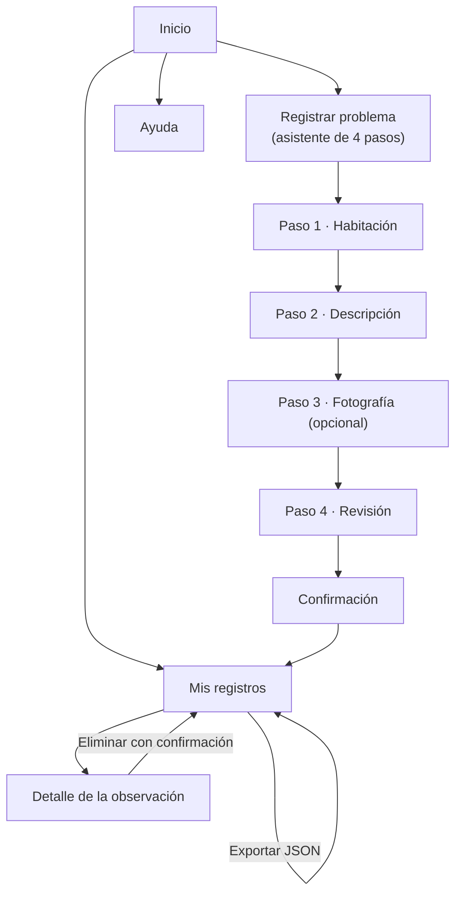
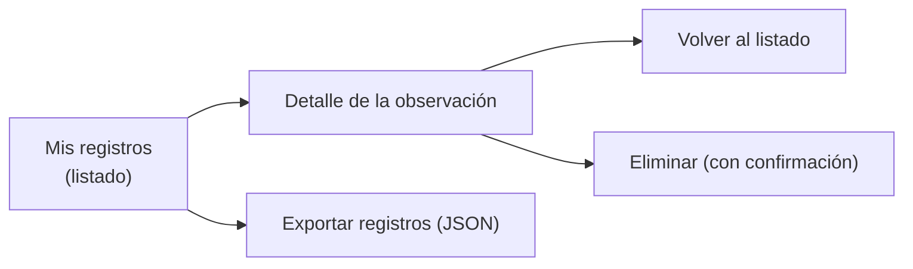

# Arquitectura de información y flujo de usuario — MiCasa Clara

**Asignatura:** Interacción Humano Computador · Universidad Mayor · Unidad 2
**Responsable de esta revisión:** Felipe Faria
**Alcance:** apartado 6 de la rúbrica (arquitectura de información y flujo de usuario), revisando la claridad de las pantallas, los botones y los pasos para **registrar** y **consultar** observaciones en el prototipo `MiCasaClara.html`.

Este documento recoge la revisión de la arquitectura de información del prototipo y del recorrido que sigue la persona usuaria, organizando los contenidos, las etiquetas y la navegación en un solo lugar, y dejando por escrito tanto lo que ya funciona bien como las oportunidades de mejora que se detectaron al recorrer la solución, de modo que el resto del equipo pueda revisarlas antes de incorporarlas.

## 1. Mapa de contenidos

El prototipo se organiza en tres secciones principales accesibles desde la barra de navegación inferior, Inicio, Mis registros y Ayuda, y desde Inicio se despliega el asistente de registro que divide la tarea en cuatro pasos, de manera que la estructura es poco profunda y mantiene a la persona siempre a uno o dos toques de su objetivo.

La profundidad máxima de navegación es de tres niveles, Inicio, luego el asistente o el listado, y luego el detalle o la confirmación, lo que es adecuado para una tarea móvil breve y reduce el riesgo de que la persona se pierda dentro de la aplicación.

## 2. Etiquetas principales

Se revisaron las etiquetas visibles del prototipo para comprobar que fueran cercanas al lenguaje cotidiano y consistentes entre sí, y en la siguiente tabla se resumen las más relevantes junto con la observación correspondiente.

| Ubicación | Etiqueta actual | Observación |
|---|---|---|
| Navegación inferior | Inicio · Mis registros · Ayuda | Claras y estables; indican la sección activa con `aria-current` |
| Inicio (botón principal) | + Registrar problema | Clara y accionable |
| Inicio (botón secundario) | Ver mis registros (N) | Muestra el conteo, buen indicador de estado |
| Asistente, paso 1 | ¿Dónde está el problema? | Clara, orientada a la decisión |
| Asistente, paso 2 | Nombre breve del problema / Describe lo que ocurre | Dos campos de texto que pueden solaparse conceptualmente |
| Confirmación | Observación guardada | Correcta, pero introduce un tercer término |
| Detalle | Detalle de la observación | Correcta |
| Estado del registro | Registrado localmente | Acertada, evita sugerir una reparación oficial |

El hallazgo principal de esta revisión de etiquetas es que la aplicación nombra de tres formas distintas a una misma cosa, ya que en unas pantallas se habla de **problema**, en otras de **observación** y en la navegación de **registros**, y aunque en el contexto cada término se entiende, esa mezcla obliga a la persona a deducir que son lo mismo y rompe la consistencia que recomienda la heurística de Nielsen sobre mantener un lenguaje uniforme y coherente con el mundo real.

## 3. Flujo de usuario

### 3.1 Registrar una observación

El recorrido para registrar divide la tarea en decisiones pequeñas, mantiene visible el avance mediante una barra de progreso con `aria-valuenow`, y permite retroceder antes de guardar, lo que entrega sensación de control a la persona.

1. Desde **Inicio** se toca **+ Registrar problema** y comienza el asistente.
2. **Paso 1**, se selecciona la habitación o el espacio entre seis opciones con ícono, y el botón elegido queda marcado con `aria-pressed`.
3. **Paso 2**, se escribe un nombre breve del problema (obligatorio), opcionalmente la parte exacta, y la descripción de lo que ocurre (obligatoria), con validación que muestra un aviso y lleva el foco al mensaje de error si falta algún campo.
4. **Paso 3**, se puede adjuntar el nombre de una fotografía, dejando claro que la imagen no se guarda, solo su nombre.
5. **Paso 4**, se revisa un resumen de todos los datos antes de confirmar, y al guardar se crea la observación en el almacenamiento local y se muestra una pantalla de confirmación.

### 3.2 Consultar una observación

El recorrido para consultar es directo, desde **Mis registros** se ve el listado de observaciones guardadas, cada una con su nombre, su habitación, su fecha y su estado, y al tocar una se abre su **detalle**, desde donde se puede volver al listado, eliminar la observación con una confirmación previa, o exportar todos los registros en formato JSON.

## 4. Revisión de claridad (hallazgos)

### 4.1 Fortalezas que conviene conservar

- La tarea de registro está dividida en cuatro pasos con barra de progreso, lo que baja la carga cognitiva y evita el formulario único extenso.
- Las pantallas usan un texto de orientación (el "eyebrow", por ejemplo "Paso 1 de 4" o "Detalle de observación") que le dice a la persona dónde está en todo momento.
- La prevención de errores está bien resuelta en el registro, con validación de los campos obligatorios, un mensaje de error que recibe el foco, y una confirmación antes de eliminar.
- El estado "Registrado localmente" es una etiqueta honesta que evita que la persona crea que su problema fue enviado a una constructora, lo que cuida la confianza.

### 4.2 Oportunidades de mejora detectadas

| N° | Hallazgo | Evidencia en el prototipo | Recomendación | Responsable |
|---|---|---|---|---|
| 1 | Se usan tres términos para el mismo objeto (problema, observación, registro) | "Registrar problema" en Inicio, "Observación guardada" en la confirmación, "Mis registros" en la navegación | Unificar el vocabulario en torno a **observación**, dejando "problema" solo como apoyo descriptivo | Etiquetas en el HTML (Pablo) + documentación (Felipe) |
| 2 | Salir del asistente a mitad de camino descarta lo escrito sin avisar | La barra inferior y el botón "Cancelar" del paso 1 llaman a la navegación sin confirmación, y al volver a entrar el formulario se reinicia | Pedir una confirmación al abandonar el asistente con datos escritos, o conservar un borrador | HTML / comportamiento (Pablo) |
| 3 | "Mis registros" no ofrece buscar ni filtrar por habitación | La pantalla de registros lista todo en orden de creación, sin filtro | Agregar un filtro por habitación cuando haya varios registros, aprovechando que el modelo ya es por habitación | Mejora futura (acordar con el equipo) |
| 4 | Se alterna entre "habitación" y "espacio" | El paso 1 dice "Selecciona la habitación o espacio", las opciones incluyen "Patio / exterior" y "Otro espacio", y el detalle rotula siempre "Habitación" | Usar un término paraguas como "lugar" o "espacio" de forma consistente en las tres pantallas | Etiquetas en el HTML (Pablo) |
| 5 | El Paso 2 pide por separado "Nombre breve del problema" y "Describe lo que ocurre" | Ambos campos son de texto y la diferencia entre titular y descripción puede no quedar clara | Reforzar los textos de ayuda (hint) para separar "un título corto" de "el detalle de lo que ves" | Etiquetas en el HTML (Pablo) |

## 5. Ajustes de esta entrega

Los cambios que corresponden a mi parte, la arquitectura de información y el flujo, se materializan en documentación, por lo que esta entrega incorpora este documento con el mapa de contenidos, las etiquetas y los flujos de registro y consulta, y actualiza el `README.md` para enlazarlo, mientras que las recomendaciones que tocan directamente las etiquetas o el comportamiento del prototipo quedan listadas en la tabla anterior con su responsable, para que Pablo las aplique en el HTML y el equipo decida las mejoras futuras, respetando así la división de trabajo acordada en la que yo reviso la arquitectura y el flujo, Pablo revisa el HTML y David actualiza el informe académico.

## 6. Trazabilidad con la rúbrica

Este documento responde al apartado 6 de la ficha de actividad, que pide organizar contenidos, etiquetas, navegación y recorrido principal, y entregar como evidencia un mapa simple de contenidos, las etiquetas principales y el flujo de usuario, los tres elementos que quedan cubiertos respectivamente en las secciones 1, 2 y 3 de este archivo, mientras que la revisión de claridad de la sección 4 aporta el análisis crítico que conecta con el apartado 7 de diseño visual y emocional.

## Referencias

- Universidad Mayor. (2026). *Ficha de actividad: Interacción Humano Computador, Unidad 2* [material de asignatura].
- World Wide Web Consortium. (2023). *Web Content Accessibility Guidelines (WCAG) 2.2*. https://www.w3.org/TR/WCAG22/
- Nielsen, J. (1994). *10 usability heuristics for user interface design*. Nielsen Norman Group. https://www.nngroup.com/articles/ten-usability-heuristics/
